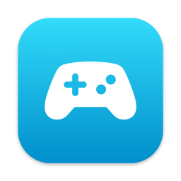
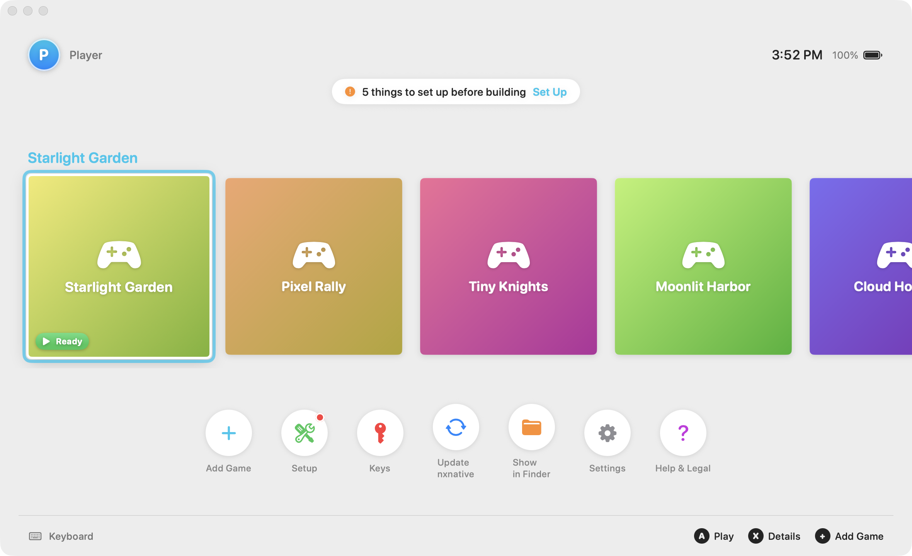
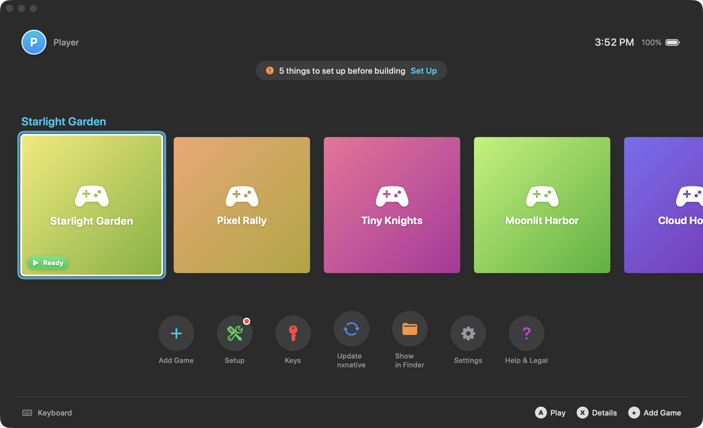
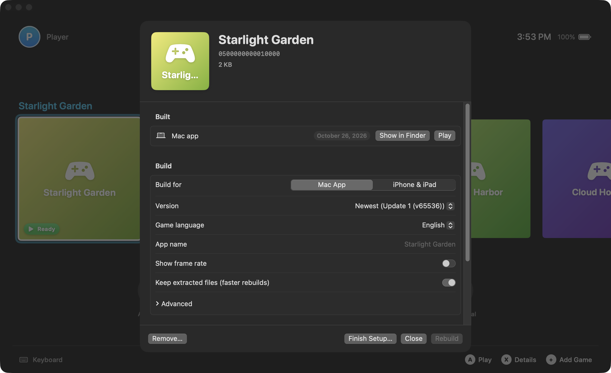
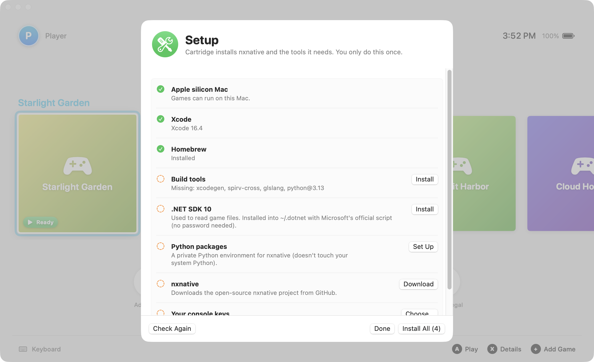

<p align="center">
  
</p>

<h1 align="center">Cartridge</h1>

<p align="center">
  A native macOS front-end for <a href="https://github.com/seedds/nxnative">nxnative</a>.<br>
  Set it up in one click, add the games you own, build, and play, with a keyboard or a controller.
</p>

<p align="center">
  
</p>

## What it does

[nxnative](https://github.com/seedds/nxnative) is an open-source project that turns games you own into apps that
run natively on Apple silicon Macs, iPhones and iPads. It's a powerful command-line tool. Cartridge wraps it in a Mac
app:

- **One-click setup.** Cartridge checks for Xcode, Homebrew and the build tools, installs .NET into `~/.dotnet`
  without an admin password, keeps nxnative's Python packages in a private environment, and downloads nxnative from
  its official repository. Every step shows its output.
- **A game library.** Drop in a folder with a game's files (base game, plus update and DLC if you have them).
  Cartridge reads the title ID and versions from the file names, flags games nxnative hasn't been tested with, and
  checks you have enough free space.
- **Builds with live progress.** Build a **Mac app** or an **iPhone & iPad IPA**. Pick the version, game language and
  app name. You can watch every stage with time estimates, stop safely, and get a notification when it's done. Your
  Mac stays awake during long builds.
- **Play.** Built Mac apps launch straight from the home screen.
- **Console-style navigation.** Arrow keys or a game controller move between tiles. **A** or Return plays,
  **X** or Space opens details, **B** closes. Light and dark mode.
- **Updates.** Cartridge checks GitHub for new releases (at launch and daily) and shows the changelog for every
  version you're missing. **Install and Relaunch** downloads it, verifies its checksum, bundle ID and code
  signature, swaps it in, and reopens. A badge also tells you when nxnative has new commits, and one click pulls
  them.

| Dark mode | Game details |
| --- | --- |
|  |  |

<p align="center"></p>

*Screenshots use fictional placeholder games.*

## Install

1. Download **Cartridge.zip** from the [latest release](../../releases/latest). It's a universal build for macOS 14
   or later.
2. Unzip it and move **Cartridge.app** to Applications.
3. The build isn't notarized, so the first time you open it macOS asks for permission. Open it once, then go to
   **System Settings → Privacy & Security** and click **Open Anyway**.

Running built games on a Mac needs Apple silicon. Building iPhone and iPad apps works on any Mac that runs Xcode.

### Build from source

```sh
git clone https://github.com/rbxrootx/cartridge.git && cd cartridge
swift test
Scripts/build.sh install
```

Every push is tested by CI. Pushing a `v*` tag publishes a release with a universal `Cartridge.zip`. Its notes are
written from the commit messages since the previous tag, and the app shows them as its changelog.

## What you need to bring

- **Your games:** the files dumped from game cards or downloads you own.
- **Your console's keys** (`prod.keys`), dumped from your own console.

Cartridge doesn't provide these, and doesn't explain where to find them.

## Legal

- Cartridge contains **no games, firmware, keys or other copyrighted material**, and doesn't download, link to or
  help find any. It only works with files already on your Mac, and never uploads anything.
- It doesn't decrypt anything itself. Builds are done by nxnative, which Cartridge downloads from its official
  repository when you ask it to. Cartridge doesn't redistribute nxnative.
- Your keys file stays where it is. Cartridge only checks that it looks like a keys file. It never displays, copies
  or sends its contents.
- Whether you may dump and use your own games and keys depends on where you live. Check your local law, and only use
  games you own.
- Cartridge isn't affiliated with or endorsed by any console maker or game publisher. All trademarks belong to their
  owners. Cover art for tested games is shown from your local nxnative checkout and isn't part of this repository.

See [CONTRIBUTING.md](CONTRIBUTING.md) for the project's rules on copyrighted material.

## How it works

```
Sources/CartridgeCore/   Toolchain checks and fixes, game folder scanning, nxnative's catalog, build-event parsing
Sources/Cartridge/       SwiftUI app: home screen, game details and build progress, setup, settings, controller input
Tests/                   Unit tests (fictional names and IDs)
Scripts/                 build.sh, screenshots.sh, icon generator
```

Builds run `scripts/build_ipa_from_nsp.py --progress json` and follow nxnative's machine-readable progress events.
Games, saves and logs are nxnative's: saves go to `~/Library/Application Support/nxnative/<title ID>/`.

## Credits

- [nxnative](https://github.com/seedds/nxnative) by seedds and contributors (MIT), and the projects it builds on.
- Cartridge is released under the [MIT License](LICENSE).
